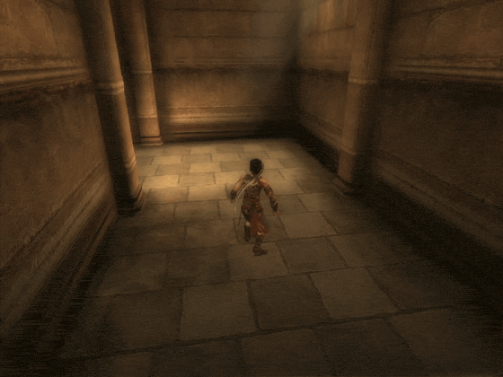
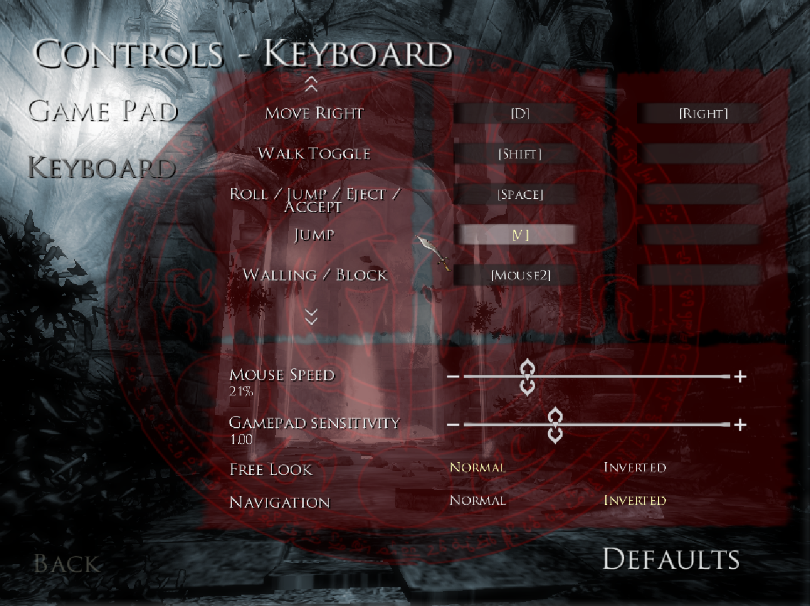
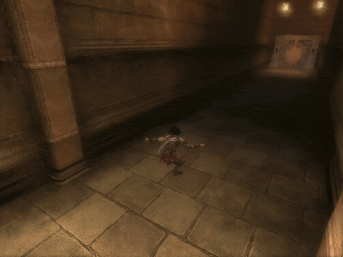
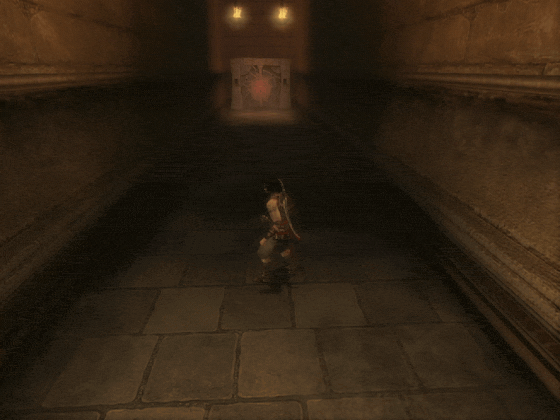
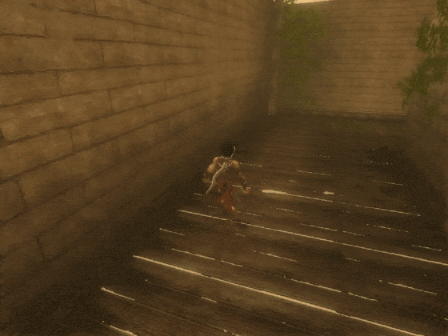
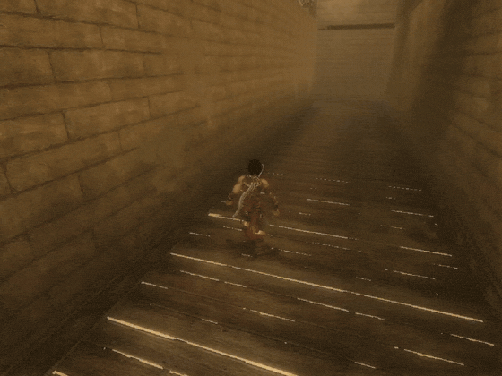

# Warrior Within movement mods

Movement mods for **Prince of Persia: Warrior Within** (Steam, 2004), applied as a byte patch to
`POP2.EXE`. This repository contains only the patcher script; no game files are included or
distributed. You need your own Steam copy of the game.

## Features

### Special Jump key

<p align="center">
  
</p>

A new "Special Jump" action in *Options > Controls*, listed after Roll/Jump, default **V**. It acts
like Space everywhere, except that Direction + Special Jump is a forward jump instead of a roll. 
Space itself is unchanged (Direction + Space still rolls). The key can be rebound like any other
action. Remember to rebind it in the menu if the profile isn't new.

<p align="center">
  
</p>

### Wall runs from jumps

<div align="center">
  <table>
    <tr>
      <th>Horizontal</th>
      <th>Vertical (optional)</th>
    </tr>
    <tr>
      <td></td>
      <td></td>
    </tr>
  </table>
</div>

You can now also start wallruns by jumping into a wall. Hold the wallrun button while jumping or
rebounding into a wall, and keep holding it to chain wallruns without pressing it again. Vertical
wallruns are optional; the patcher asks whether to include them.

### Diagonal wall jump and torpedo

<div align="center">
  <table>
    <tr>
      <th>Diagonal jump</th>
      <th>Diagonal torpedo</th>
    </tr>
    <tr>
      <td></td>
      <td></td>
    </tr>
  </table>
</div>

While wallrunning horizontally, jump off with the Special Jump key (**V**) to leap at 45 degrees
toward the direction you are running, instead of straight out from the wall. **Space still jumps 
straight out**. Together with wallruns from jumps, this lets you chain into a wallrun on the next 
wall, for example around a corner.

Press the Special Jump key together with the primary attack (**V + Left click**) to launch the 
torpedo attack along the same diagonal instead, with or without an enemy nearby.

### Wall slide (optional) Work in Progress

Hold the drop button (**C**) in the air against a wall to slide down it, like on a curtain, swords 
drawn. Steer left and right while sliding, jump off with **Space** (straight out) or **Space + 
direction** (45 degrees to that side), or release **C** to let go. The patcher asks whether to
include it.

Holding **C** also starts a slide when you drop from a ledge or a wallrun ends next to a wall, without
touching it first. No slide starts when a ledge you can grab is just below or the floor is close.

### Story-trigger fix

Made story triggers less likely to be skipped by jumping over them.

## Requirements

- The Steam version of the game, with an unmodified `POP2.EXE`
  (sha256 `5559117d013155bbad608cedc2fd0dd272f37ed92c936fc4e151287f3b5ff1cb`).
- Python 3.8 or newer. No other dependencies.

## Install

1. Back up `POP2.EXE` from the game folder.
2. Run:

   ```
   python pop2_movement_patch.py "<game folder>/POP2.EXE" [output path]
   ```

   The script asks whether to include vertical wall runs from jumps and the wall slide (press
   Enter for yes). To skip the questions, add `--vertical-wallruns` or `--no-vertical-wallruns`,
   and `--wall-slide` or `--no-wall-slide`. The output defaults to
   `POP2_patched.EXE` next to the input; if you give a folder, the file is written there under that
   name. The input is never modified.
3. Replace `POP2.EXE` with the patched file (rename it to `POP2.EXE`).

The script refuses any input that is not the original Steam exe, checks every byte before changing
it, and verifies the sha256 of the result:

| Version | sha256 |
|---|---|
| Vertical wall runs and wall slide (default) | `cf4b50c6089071b69b8a9fd671db2314e5f267ae0a762a8ff17d67f046445f0b` |
| Vertical wall runs, no wall slide | `89815876a23200f8c3a47a752dae98d4778c2f075b09f1f7ffae740769b32c0b` |
| Horizontal wall runs only, wall slide | `893a1c5e70ea80afb6fb30cdab84f7f245df669d1c63073bc1d35247a2a3301a` |
| Horizontal wall runs only, no wall slide | `ab030994cc2862e6bcd3cf4425b392e63349abcb6aa7a81943ad1b958635feeb` |

If you previously applied an older version of these mods, restore the original exe first (from your
backup, or *Steam > Properties > Installed Files > Verify integrity*).

## Uninstall

Restore your backup of `POP2.EXE`, or let Steam verify the game files.

## Disclaimer

Unofficial fan modification, not affiliated with or endorsed by Ubisoft. Prince of Persia is a
trademark of Ubisoft Entertainment. Use at your own risk and keep a backup.

## License

The patcher scripts are released under the [MIT License](LICENSE). This covers the scripts only,
not the game or its files.
