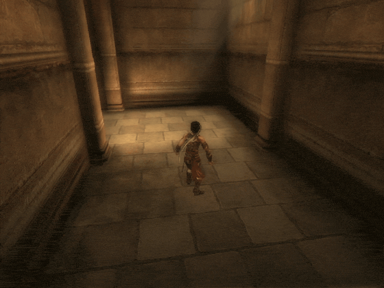
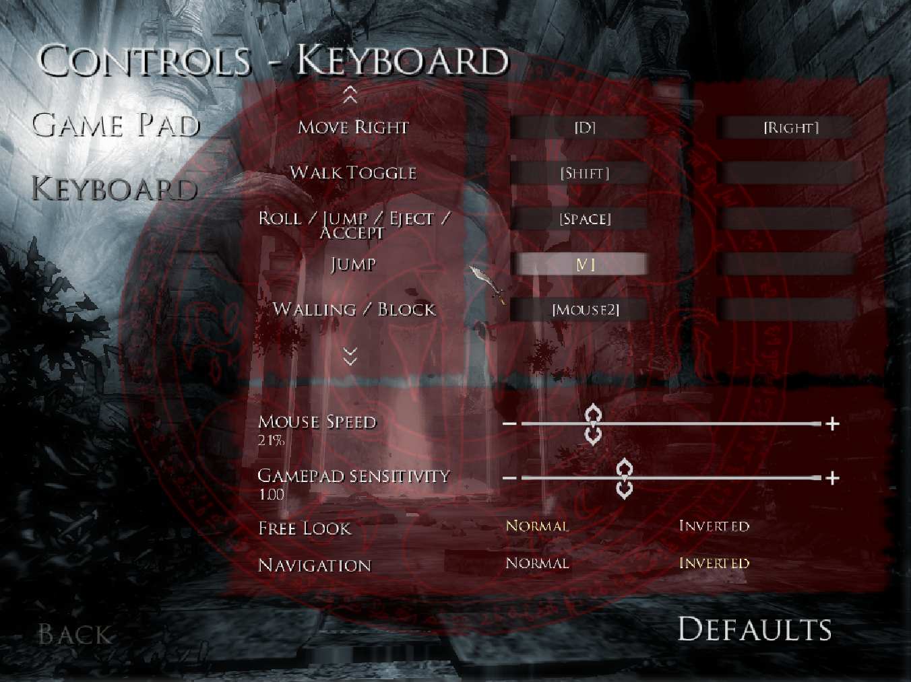
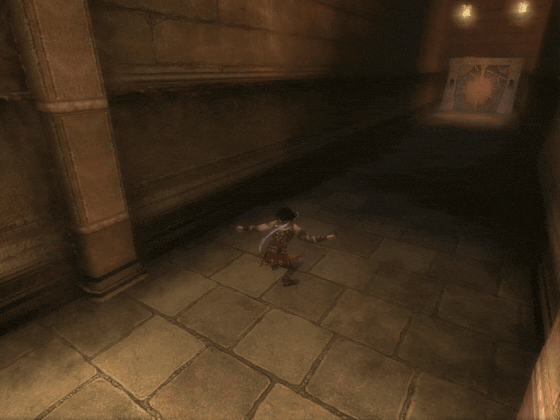
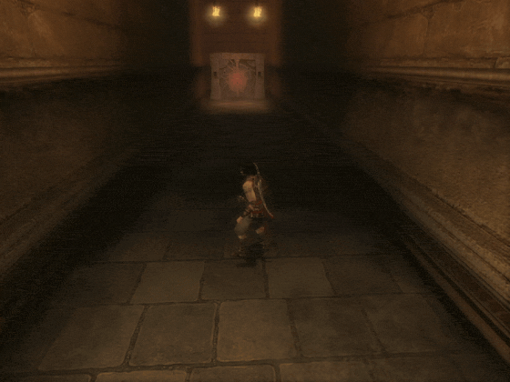

# Warrior Within movement mods

Movement mods for **Prince of Persia: Warrior Within** (Steam, 2004), applied as a byte patch to
`POP2.EXE`. This repository contains only the patcher script; no game files are included or
distributed. You need your own Steam copy of the game.

## Features

### Jump key

<p align="center">
  
</p>

A new "Jump" action in *Options > Controls*, listed after Roll/Jump, default **V**. It acts like
Space everywhere, except that Direction + Jump is a forward jump instead of a roll. Space itself is
unchanged (Direction + Space still rolls). The key can be rebound like any other action. Remember
to rebind it in the menu if the profile isn't new.

<p align="center">
  
</p>

### Wall runs from jumps

<div align="center">
  <table>
    <tr>
      <th>Horizontal</th>
      <th>Vertical (optional)</th>
    </tr>
    <tr>
      <td></td>
      <td></td>
    </tr>
  </table>
</div>

You can now also start wallruns by jumping into a wall. Hold the wallrun button while jumping or
rebounding into a wall, and keep holding it to chain wallruns without pressing it again. Vertical
wallruns are optional; the patcher asks whether to include them.

### Angled wall jump

While wallrunning horizontally, jump off with the Jump key (**V**) to leap at 45 degrees toward the
direction you are running, instead of straight out from the wall. Space still jumps straight out.
Together with wallruns from jumps, this lets you chain into a wallrun on the next wall, for example
around a corner.

### Story-trigger fix

Made story triggers less likely to be skipped by jumping over them.

## Requirements

- The Steam version of the game, with an unmodified `POP2.EXE`
  (sha256 `5559117d013155bbad608cedc2fd0dd272f37ed92c936fc4e151287f3b5ff1cb`).
- Python 3.8 or newer. No other dependencies.

## Install

1. Back up `POP2.EXE` from the game folder.
2. Run:

   ```
   python pop2_movement_patch.py "<game folder>/POP2.EXE" [output path]
   ```

   The script asks whether to include vertical wall runs from jumps (press Enter for yes). To skip
   the question, add `--vertical-wallruns` or `--no-vertical-wallruns`. The output defaults to
   `POP2_patched.EXE` next to the input; if you give a folder, the file is written there under that
   name. The input is never modified.
3. Replace `POP2.EXE` with the patched file (rename it to `POP2.EXE`).

The script refuses any input that is not the original Steam exe, checks every byte before changing
it, and verifies the sha256 of the result:

| Version | sha256 |
|---|---|
| With vertical wall runs (default) | `d938ffb98c67a49d30a41130a876b7fedda2eaf5e9dee9570cbe945fe54b025a` |
| Horizontal wall runs only | `3245e9119059103d989e168dd98ee4ef9c065914c3f6f87547ff751b28c6a412` |

If you previously applied an older version of these mods, restore the original exe first (from your
backup, or *Steam > Properties > Installed Files > Verify integrity*).

## Uninstall

Restore your backup of `POP2.EXE`, or let Steam verify the game files.

## Disclaimer

Unofficial fan modification, not affiliated with or endorsed by Ubisoft. Prince of Persia is a
trademark of Ubisoft Entertainment. Use at your own risk and keep a backup.

## License

The patcher scripts are released under the [MIT License](LICENSE). This covers the scripts only,
not the game or its files.
